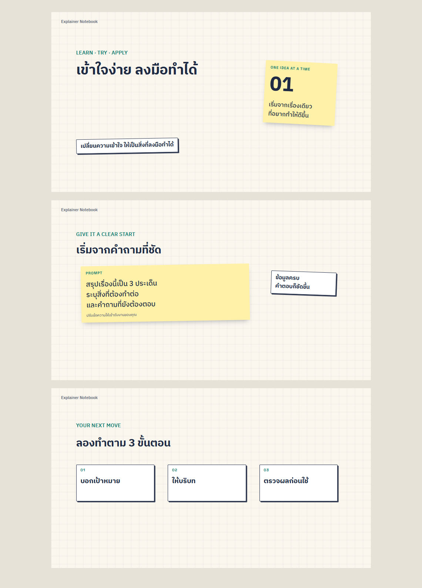

# Explainer Notebook Kit

ธีมสำหรับคลิปสอนงานและ explainer: กระดาษตารางสีครีม ตัวอักษรหมึกน้ำเงิน ไฮไลต์เหลือง sticky notes และการ์ดอธิบายเป็นขั้นตอน **ใช้กับแบรนด์หรือมาสคอตอะไรก็ได้ และไม่ใส่มาสคอตก็ได้**



## ใครเอาไปใช้ได้ และเริ่มอย่างไร

Repo นี้เป็น **private** คนที่จะ clone ต้องได้รับสิทธิ์เข้าถึงจากเจ้าของ `mingssii-cpf` ก่อน เมื่อมีสิทธิ์แล้ว:

```powershell
git clone https://github.com/mingssii-cpf/ez-training-kit.git
cd ez-training-kit
python skills/explainer-notebook/scripts/new_episode.py ./episodes my-lesson --title "ประชุมให้ได้ข้อสรุป" --preview
```

เปิด `episodes/my-lesson/preview.html` ในเบราว์เซอร์ จะเห็นตัวอย่างนิ่ง 3 ฉากทันที **ขั้นนี้ใช้แค่ Python ไม่ต้องมีเสียงหรือ render วิดีโอก่อน** ส่วน `index.html` เป็น composition สำหรับ HyperFrames ไม่ใช่ player

## ใส่แบรนด์และตัวละครของตัวเอง

```powershell
python skills/explainer-notebook/scripts/new_episode.py ./episodes team-lesson --title "สื่อสารงานให้ชัดเจน" --brand "ทีมของเรา" --logo ./my-assets/logo.png --mascot ./my-assets/character.webp --preview
```

- ไม่ส่ง `--mascot`: ใช้การ์ด notebook แทนตัวละคร
- ไม่ส่ง `--logo`: ไม่มีโลโก้
- ส่งเฉพาะ `--logo` หรือเฉพาะ `--mascot` ก็ได้ รองรับ PNG, JPEG, WebP และ SVG
- รูปตัวละครพื้นหลังโปร่งใสจะวางกับกระดาษได้ง่าย ระบบรักษาสัดส่วนภาพ
- หากต้องการ EZ/CPF แบบเดิม เพิ่ม `--preset ez`; ภาพที่ส่งเองจะ override preset นั้น
- คำสั่งไม่เขียนทับตอนที่มีอยู่แล้ว ให้แก้ไฟล์ในตอนเดิมหรือใช้ชื่อโฟลเดอร์ใหม่

ดู [ตัวอย่างเปลี่ยนเป็นตัวละครอื่น](docs/custom-preview.png) — ยังคงธีมเดียวกันโดยไม่ใช้ EZ

| อยากเปลี่ยนอะไร | แก้ที่ไฟล์ในโฟลเดอร์ตอน |
|---|---|
| ชื่อเรื่อง เนื้อหา prompt และ 3 ขั้นตอน | `script.json` |
| ชื่อแบรนด์ โลโก้ มาสคอต | `brand.json` และไฟล์ใน `public/` |
| สี ฟอนต์ และหน้าตาองค์ประกอบ | `tools/style.css` |
| จัดวางภาพและการเคลื่อนไหว | `tools/build.py` |

ใน `brand.json` ตั้ง `logo` หรือ `mascot` เป็น `null` เพื่อนำออก เปลี่ยนแล้วรัน:

```powershell
python episodes/team-lesson/tools/build.py
```

ไฟล์ build และ assets ถูกคัดลอกไปในตอนแล้ว ย้ายโฟลเดอร์ตอนทั้งก้อนไปเครื่องอื่นแล้ว build ต่อได้ ไม่ผูกกับ path เครื่องผู้สร้าง

## ใช้กับ AI เป็น skill

ตัว skill อยู่ที่ [skills/explainer-notebook/SKILL.md](skills/explainer-notebook/SKILL.md) พร้อม supporting files ในโฟลเดอร์เดียวกัน ให้ AI อ่านไฟล์นี้จาก repo ได้เลย ตัวอย่างคำสั่ง:

> อ่าน skills/explainer-notebook/SKILL.md แล้วทำคลิปสอนเรื่องการส่งต่องาน ใช้ธีม notebook นี้ ใช้โลโก้และมาสคอตของฉันจาก my-assets ให้ดู preview ก่อน เลือกเสียงผู้บรรยายให้เข้ากับงานนี้

หากต้องการให้ agent ค้นพบเป็น skill ที่ติดตั้ง ให้ใช้ตัวติดตั้ง skill ของ agent นั้นกับ **ทั้งโฟลเดอร์ explainer-notebook** ไม่ใช่คัดลอกแค่ SKILL.md การอัปเดต repo นี้ไม่ได้ติดตั้ง skill ลงเครื่องให้อัตโนมัติ

## จาก preview เป็นวิดีโอจริง

1. ปรับบทและฉากให้ตรงเรื่อง เลือกเสียงบรรยายและเพลงตามงาน ไม่ได้บังคับ Copilot, HR, EZ หรือผู้ให้บริการเสียง
2. ใส่เสียงจริงเป็น `audio/voice/<scene-id>.wav` ในโฟลเดอร์ตอน
3. จาก root ของ repo รัน:

   ```powershell
   python skills/explainer-notebook/scripts/align.py episodes/my-lesson
   python episodes/my-lesson/tools/build.py
   cd episodes/my-lesson
   npm run check
   npm run render -- --fps 30 --quality standard --workers 2 --output renders/my-lesson.mp4
   ```

4. กลับมาที่ root ของ repo แล้วรัน `python skills/explainer-notebook/scripts/qa.py episodes/my-lesson episodes/my-lesson/renders/my-lesson.mp4` และตรวจภาพ/เสียงของไฟล์จริง

Preview เป็นภาพตัวอย่างพร้อม timing สมมติ ไม่มีเสียงบรรยาย ต้องใช้ `align.py` จับเวลาจากเสียงจริงก่อนผลิตคลิปที่มีเสียง ขั้นผลิตใช้ Node.js/npm และ FFmpeg/ffprobe เพิ่มเติม; Pillow ใช้เฉพาะ redact และ NumPy ใช้เฉพาะ compose_bgm

ดู [ขั้นตอนผลิต](skills/explainer-notebook/references/workflow.md), [สเปกธีม](skills/explainer-notebook/references/frame.md) และ [scene helpers](skills/explainer-notebook/references/eplib.md)

## ขอบเขตและการดูแล

เจ้าของ `mingssii-cpf` · งาน `KIT-002` · 2026-10-26 · repo เดิมยังคงเป็น private ชื่อ ez-training-kit แต่ skill หลักเปลี่ยนเป็น explainer-notebook ตามที่ผู้ใช้ขอให้ใช้ธีมกับมาสคอตอื่นได้

คำสั่งเดิมใน skills/ez-training-clip เปลี่ยนเป็น skills/explainer-notebook; ไฟล์เสียงใช้ audio/voice แทน audio/gemini; ส่วน branding เดิมเลือกด้วย --preset ez ตัว skill ต้นฉบับบนเครื่องผู้ใช้ไม่ได้ถูกแก้

[Source manifest](SOURCE-MANIFEST.json) เป็นประวัติของชุด EZ เริ่มต้นใน commit bc25671 ไม่ใช่ checksum ของรุ่นที่ปรับแล้ว โลโก้ CPF/EZ เป็นทรัพย์สินแบรนด์เดิมและอยู่ใน preset เท่านั้น ไม่มีการให้สิทธิ์นำไปใช้กับแบรนด์อื่น; ไฟล์ SFX/ฟอนต์คงเครดิตเดิม ชุดนี้ไม่ได้ประกาศ open-source license ครอบทุกไฟล์

คำสั่งตรวจ: `python tools/check.py` ครอบคลุม default ไม่มีแบรนด์, โลโก้อย่างเดียว, มาสคอตอย่างเดียว, custom branding, EZ preset, ปฏิเสธข้อมูลไม่ถูกต้อง/การเขียนทับ, HTML build และย้ายโฟลเดอร์ตอน การตรวจนี้ไม่แทนการ render และ QA วิดีโอจริง

สถานะ KIT-002: template และ preview ทั่วไปตรวจผ่านแล้ว รวม skill validator และตรวจภาพใน Chrome ที่ไม่มีแบรนด์, custom character, EZ preset และชื่อเรื่องยาว ไม่พบภาพหายหรือองค์ประกอบล้นกรอบ; ภาพใน docs มาจาก starter รุ่นนี้ ไม่ได้ render/ตรวจวิดีโอจริงในงานนี้

README นี้เป็นคู่มือและสถานะหลัก รุ่นที่เผยแพร่คือ branch main บน GitHub; ขั้นถัดไปสำหรับผู้ใช้คือ clone, สร้าง preview แล้วเปลี่ยนเนื้อหาและภาพของตนเอง
